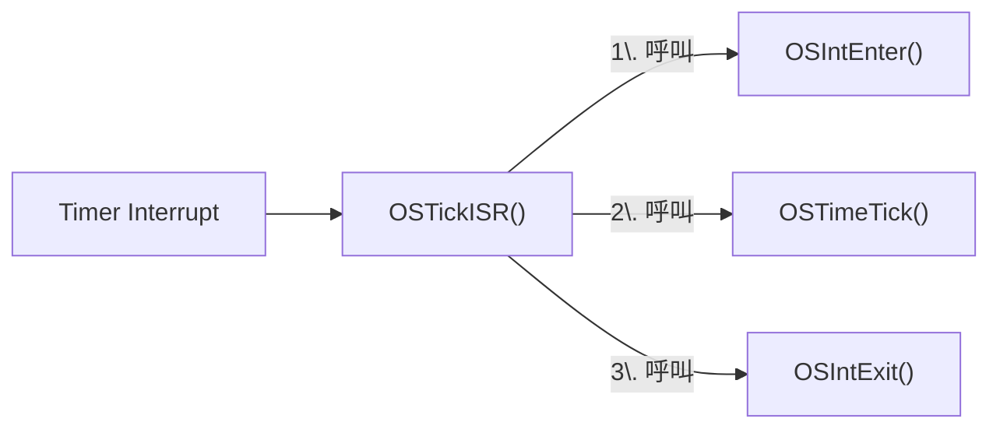

# Lab2

## 1. 題目

- 模擬 periodic tasks EDF (Earliest Deadline First) scheduling
    - EDF: 動態依照每個 job 目前剩下的 deadline 遠近決定優先權，deadline 越近越優先執行的 dynamic-priority 排程演算法
- 測試資料：
    - Task set 1 = { t1(1,3), t2(3,5) }
    - Task set 2 = { t1(1,4), t2(2,5), t3(2,10) }
- 其他假設或要求
    - Tasks all arrive at the same time
    - Show context switch behaviors
    - Show deadline violations if there is any

## 2. 相關 Kernel Function

`OSStart`、`OS_Sched`、`OS_TCBInit`、`OS_InitMisc` 跟 lab1 一樣，可以直接參考 [lab1.md](/lab1/lab1.md#2-相關-kernel-function)。

### Interrupt



- **OSTickISR**（組語，`OS_CPU_A.ASM`）：timer 中斷真正的進入點，依序做：
    1. `PUSHA` / `PUSH ES` / `PUSH DS`：把被中斷的 task 當下所有暫存器（AX/BX/CX/DX/SP/BP/SI/DI、ES、DS）全部存到**它自己的 stack** 上
    2. `OSIntNesting +1`；如果這是最外層中斷（`OSIntNesting == 1`），把目前的 SS:SP（也就是剛剛那堆暫存器存放的位置）記到這個 task 的 TCB 裡（`OSTCBCur->OSTCBStkPtr`）——這就是 context switch 真正要保存的東西：不是複製暫存器內容，而是記住「這個 task 的暫存器現在存在哪裡」
    3. 通知 PIC 這次中斷處理完了（順便維持 DOS 自己的系統時間）
    4. `CALL OSTimeTick`，再 `CALL OSIntExit`
    5. 如果 `OSIntExit` 沒有決定換人，就直接把剛剛存的暫存器原封不動還原、`IRET`，繼續跑同一個 task

- **OSIntEnter**：標記目前在 ISR 裡（`OSIntNesting+1`），避免中斷還沒處理完就被排程

- **OSTimeTick**：被 `OSTickISR` 呼叫，在 ISR context 裡執行，掃過 `OSTCBList`，幫每個還在 delay 的 task 把倒數 tick 數減一，倒數到 0 就標記回 ready table。

- **OSIntExit**：負責在系統從 ISR 呼叫返回之後，判斷要不要重新 schedule（會不會發生 context switch）。被 `OSTickISR` 呼叫，先把 `OSIntNesting` -1，只有降到 0（代表這是最外層、也是最後一層巢狀中斷）且 scheduler 沒被 lock，才會去挑現在 ready 裡面優先權最高的 task；挑出來的如果跟目前執行的不一樣，才呼叫 `OSIntCtxSw()` 真正做 context switch（細節見下）。

- **OSIntCtxSw**：真正執行 context switch 的地方。做的事：把 `OSTCBCur`/`OSPrioCur` 換成 `OSTCBHighRdy`/`OSPrioHighRdy`，然後把 SS:SP 換成新 task 自己的 `OSTCBStkPtr`（新 task 之前被中斷時存的那個位置），接著把新 task 的暫存器 `POP` 回來、`IRET`。這個 `IRET` 跳回去的位置跟 flags 都是新 task 自己之前存的，所以執行流程就直接接到新 task 原本被中斷的地方繼續跑。做完這一步就不會再回到 `OSTickISR` 原本的還原流程，因為已經用新 task 的 stack `IRET` 出去了。

## 3. 做法

### 3.1 Recap（跟 lab1 相同的部分）

這個 lab 延續 lab1 的架構，只是把排程演算法從 RM 換成 EDF。以下這些跟 [lab1.md](/lab1/lab1.md) 完全一樣，細節不重複寫：

- TCB 擴充欄位：`compTime`（volatile）/ `period` / `releaseTick` / `deadline`，欄位名稱都跟 lab1 一樣
    - `deadline` 存的是絕對時間（不是相對 period 的時長）
- TaskStart / BaseTask 的整體流程（建立 task → 初始化 TCB → busy-wait 消耗 compTime → 準備下一個 job）
- msg 結構 + OSMsgRing/OSMsgHead/OSMsgTail ring buffer 機制
- OSMissTaskPrio / OSMissDeadlineTick 的 deadline miss 紀錄機制
- OS_InitMisc 初始化 global variables
- OS_AddMsg / OS_DumpMsg 的實作
- OSTimeTick 遞減 compTime、檢查 deadline 的邏輯（多了幾個 null check，整體跟 lab1 一樣）

### 3.2 Application Code

- refer to : [TEST.C](/lab2/SOFTWARE/uCOS-II/LAB2/BC45/SOURCE/TEST.C)

    大致上的流程跟 lab1 一樣，只是排程演算法從 RM 換成 EDF：

    ```mermaid
    flowchart LR
        A[main: OSInit] --> B[建立 TaskStart]
        B --> C[OSStart 開始 multitasking]
        C --> D[TaskStart: 裝 tick ISR]
        D --> E[建立 application tasks]
        E --> F[OSTimeSet 歸零時間]
        F --> G[TaskStart 閒置迴圈]
        E --> H[task 執行 BaseTask]
        H --> I[初始化自己的 TCB 欄位]
        I --> J{有 deadline miss?}
        J -- 有 --> K[印出 log 並結束程式]
        J -- 沒有 --> L[busy-wait 消耗 compTime]
        L --> M[印出排程 log]
        M --> N[更新下一個 job 的 release / deadline]
        N --> O[delay 到下次 release]
        O --> J
    ```

> [!NOTE]
> 目前用註解切換測資：預設是 Task set 1（Task1 + Task2），Task set 2（+Task3）被註解掉了，要換測資去 [TEST.C](/lab2/SOFTWARE/uCOS-II/LAB2/BC45/SOURCE/TEST.C) 改註解。

### 3.3 ucOS Kernel Code Modified（只列跟 lab1 不一樣的地方）

- refer to :
    - [uCOS_II.H](/lab2/SOFTWARE/uCOS-II/SOURCE/uCOS_II.H)
    - [OS_CORE.C](/lab2/SOFTWARE/uCOS-II/SOURCE/OS_CORE.C)

#### OS_CORE.C

- 新增 OS_EDF：掃過 OSTCBList，在系統還沒發生過 deadline miss 的前提下，從「period > 0 且 compTime > 0 且目前 ready」的 task 中挑 deadline 最小的那個，挑不到就回傳 NULL：[L1254-1273](/lab2/SOFTWARE/uCOS-II/SOURCE/OS_CORE.C#L1254-L1273)
- OSStart 改成先呼叫 OS_EDF 選第一個要跑的 task，挑不到（代表沒有 periodic task ready）才 fallback 回原本的 priority table：[L318-331](/lab2/SOFTWARE/uCOS-II/SOURCE/OS_CORE.C#L318-L331)
- OS_Sched 同樣改成先呼叫 OS_EDF，挑不到才 fallback 回 priority table，排程成功才紀錄 complete 事件：[L936-957](/lab2/SOFTWARE/uCOS-II/SOURCE/OS_CORE.C#L936-L957)
- OSIntExit 同樣改成呼叫 OS_EDF 決定下一個要跑的 task：[L190-211](/lab2/SOFTWARE/uCOS-II/SOURCE/OS_CORE.C#L190-L211)
