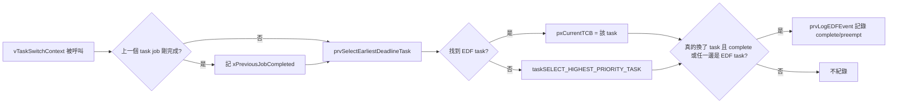

# Lab4

## 1. 題目

- 幫 FreeRTOS 實作 **EDF (Earliest Deadline First) scheduler**（NYCU ESSLab，跟 lab2 在 uC/OS-II 上做的是同一個概念，這次换到 FreeRTOS 上）
- 關鍵提示（來自投影片）：
    - 排程決策的地方是 `vTaskSwitchContext()`
    - 幫 TCB 加上 deadline 資訊
    - 在排程點用 deadline 最早的 ready task，**linear search 就可以**
- 測試資料（跟 lab2 一樣的兩組 task set）：
    - Task set 1 = `{ t1(1,3), t2(3,5) }`
    - Task set 2 = `{ t1(1,4), t2(2,5), t3(2,10) }`
- 其他提示
    - `printf()` 只能在 `main.c`（task context）呼叫，不要在 ISR 或 kernel 的 `tasks.c` 裡直接印——先緩衝起來，之後再一次印出
    - task 建立的順序可以自己調整，因為系統預設會先跑「最後建立」的那個 task

## 2. 相關 Kernel Function

這次改的是 FreeRTOS 本身排程決策的地方，不是新增獨立的 helper：

- **`vTaskSwitchContext()`**：FreeRTOS 排程器真正決定「下一個要跑的 task 是誰」的地方，每次需要排程（tick 到期、task 被阻塞/喚醒等）就會呼叫
- **`taskSELECT_HIGHEST_PRIORITY_TASK()`**：FreeRTOS 原本的 fixed-priority 選取 macro，掃 ready list bitmap 找優先權最高的 task
- **TCB（`tskTaskControlBlock`）**：每個 task 的控制結構，`vTaskSwitchContext()` 選完就是把 `pxCurrentTCB` 指到新的 TCB

## 3. 做法

### 3.1 Application Code

- refer to : [main.c](/lab4/main.c)

    ```mermaid
    flowchart LR
        A[main] --> B[main_lab4]
        B --> C[印出每個 task 的 c/p]
        C --> D[反向建立 task，讓 T1 最後建立最先跑]
        D --> E[vTaskEDFSetTaskInfo 設定 period/deadline]
        E --> F[vTaskStartScheduler]
        F --> G[prvLabEDFTask 迴圈]
        G --> H{tick >= 時間上限?}
        H -- 是 --> I[prvLabPrintOutputOnce 印 log]
        I --> J[vTaskSuspend 把自己停掉]
        H -- 否 --> K[prvLabRunForTicks 消耗 c ticks]
        K --> L[vTaskEDFMarkJobComplete]
        L --> M[deadline += period]
        M --> N[vTaskEDFSetDeadline]
        N --> O[vTaskDelayUntil 睡到下個 period]
        O --> G
    ```

- **`main_lab4()`**：依 `mainLAB_TASK_SET` 建立 spec 的 task set，用 `xTaskCreate()` 建立每個 `prvLabEDFTask`，再呼叫 `vTaskEDFSetTaskInfo()` 把 task number、period、第一個 deadline 寫進 TCB：[L143-189](/lab4/main.c#L143-L189)
- **`prvLabEDFTask()`**：每個 period 的工作迴圈——跑完 `c` ticks、標記 job 完成、把 deadline 往後推一個 period、`vTaskDelayUntil()` 睡到下一個 period：[L192-214](/lab4/main.c#L192-L214)
- **`prvLabRunForTicks()`**：用忙等（busy-wait）消耗掉 `c` 個 tick，模擬計算時間：[L217-233](/lab4/main.c#L217-L233)
- **`prvLabPrintOutputOnce()`**：從 task context 一次印出整個緩衝的排程 log，`xLabOutputPrinted` 旗標確保只有第一個跑到時間上限的 task 會印：[L250-284](/lab4/main.c#L250-L284)

> [!NOTE]
> 用 `#define mainLAB_TASK_SET` 切換要跑哪組 task set（1 或 2）。

> [!NOTE]
> 建立 task 用的是反向迴圈（從最後一個 task 建到第一個），對應 `spec-hint.md` 的提示：FreeRTOS 預設會先跑「最後建立」的 task，反著建立才能讓 `T1` 最後建立、最先被排到。

### 3.2 FreeRTOS Kernel Modified（跟原生 FreeRTOS 不一樣的地方）

- refer to :
    - [FreeRTOS_Source/tasks.c](/lab4/FreeRTOS_Source/tasks.c)
    - [FreeRTOS_Source/include/task.h](/lab4/FreeRTOS_Source/include/task.h)

#### task.h

- 新增 `TaskEDFLogEvent_t`（紀錄一筆排程事件：tick、是 complete 還是 preempt、from/to 的 task number）：[L89-97](/lab4/FreeRTOS_Source/include/task.h#L89-L97)
- 新增 EDF 控制 API 宣告（`vTaskEDFSetTaskInfo`/`vTaskEDFSetDeadline`/`vTaskEDFMarkJobComplete`/`vTaskEDFClearLog`/`uxTaskEDFGetLogCount`/`xTaskEDFGetLogEvent`），完全沒有動到 `xTaskCreate()` 原本的介面：[L367-378](/lab4/FreeRTOS_Source/include/task.h#L367-L378)

#### tasks.c

- TCB 多 5 個 EDF metadata 欄位：是否啟用 EDF、task number、period、absolute deadline、這次 job 是否已完成：[L269-274](/lab4/FreeRTOS_Source/tasks.c#L269-L274)
- 建立 task 時預設關閉 EDF（`xEDFEnabled=pdFALSE`，deadline 設成 `portMAX_DELAY`，確保沒被 `vTaskEDFSetTaskInfo()` 設定過的 task 永遠不會被 EDF 選到）：[L930-934](/lab4/FreeRTOS_Source/tasks.c#L930-L934)
- 新增固定大小（32 筆）的 event buffer，只在 `main_lab4()` 設定的 tick 上限之內紀錄事件：[L389-393](/lab4/FreeRTOS_Source/tasks.c#L389-L393)
- 新增 `prvSelectEarliestDeadlineTask()`：linear search 掃過**所有** priority 的 ready list，從有啟用 EDF 的 task 裡挑 `xEDFAbsoluteDeadline` 最小的那個：[L3032-3089](/lab4/FreeRTOS_Source/tasks.c#L3032-L3089)
- 新增 `prvLogEDFEvent()`：把一筆 context switch 事件寫進 buffer：[L3092-3111](/lab4/FreeRTOS_Source/tasks.c#L3092-L3111)
- 新增 `vTaskEDFSetTaskInfo`/`vTaskEDFSetDeadline`/`vTaskEDFMarkJobComplete`/`vTaskEDFClearLog`/`uxTaskEDFGetLogCount`/`xTaskEDFGetLogEvent` 這組 API 的實作：[L3114-3195](/lab4/FreeRTOS_Source/tasks.c#L3114-L3195)
- `vTaskSwitchContext()` 改成先問 EDF：
    - 先看上一個 task 的 job 是不是剛完成，記下來給 log 判斷 complete/preempt 用：[L3200-3211](/lab4/FreeRTOS_Source/tasks.c#L3200-L3211)
    - 呼叫 `prvSelectEarliestDeadlineTask()`，有找到才用，找不到（沒有 EDF task ready）才 fallback 回原本的 `taskSELECT_HIGHEST_PRIORITY_TASK()`：[L3256-3276](/lab4/FreeRTOS_Source/tasks.c#L3256-L3276)
    - 真的換了 task，而且（job 剛完成 或 新舊 task 任一邊有啟用 EDF）才記一筆 log：[L3278-3288](/lab4/FreeRTOS_Source/tasks.c#L3278-L3288)



> [!NOTE]
> `prvSelectEarliestDeadlineTask()` 跟 lab2 的 `OS_EDF()` 思路一樣：線性掃過所有 ready task，挑 deadline 最小的；挑不到（沒有已啟用 EDF 的 ready task）就 fallback 回原本的排程方式。`vTaskSwitchContext()` 判斷要不要 fallback、要不要記 log 的寫法也跟 lab2 的 `OSIntExit`/`OS_Sched` 結構幾乎一樣。

## 4. 執行驗證

沒有找到能直接跑這個 project 的模擬器：QEMU 主線從未支援 MSP430（官方 maintainer 2021 年在 mailing list 上明確證實沒有這顆 CPU 的 emulation），唯一找到的 out-of-tree `qemu-system-msp430` fork（2016 年、QEMU 2.4 時代）實際拿 FreeRTOS 去跑也是失敗的；Renode 只有通用 MSP430 ISA、沒有 FR5994 的平台描述檔，要自己寫；或是把 project 搬去 FreeRTOS 的 POSIX simulator，但要 mock 掉所有硬體相關的部分，工夫都遠超過「跑一下驗證」的範圍。所以這份文件沒有實際編譯執行過，是單純讀 code 整理出來的。
