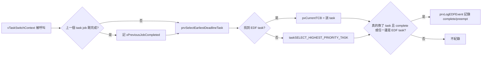

# Lab4

## 1. 題目

- 幫 FreeRTOS 實作 **EDF (Earliest Deadline First) scheduler**（跟 lab2 在 uC/OS-II 上做的是同一個概念，這次换到 FreeRTOS 上）
- 關鍵提示（來自投影片）：
    - 排程決策的地方是 `vTaskSwitchContext()`
    - 幫 TCB 加上 deadline 資訊
    - 在排程點用 deadline 找最早的 ready task
- 測試資料（跟 lab2 一樣的兩組 task set）：
    - Task set 1 = `{ t1(1,3), t2(3,5) }`
    - Task set 2 = `{ t1(1,4), t2(2,5), t3(2,10) }`
- 其他提示
    - `printf()` 只能在 `main.c`（task context）呼叫，不要在 ISR 或 kernel 的 `tasks.c` 裡直接印。可以先 buffer 起來，之後再一次印出

## 2. 相關 Kernel Function

- **`vTaskSwitchContext()`**：FreeRTOS scheduler 真正決定「下一個要跑哪個 task」的地方，每次需要排程（tick 到期、task 被阻塞/喚醒等）就會呼叫
- **`taskSELECT_HIGHEST_PRIORITY_TASK()`**：FreeRTOS 原本的 fixed priority scheduling 中負責選下一個 task 的 macro，會掃過 ready list bitmap 找優先權最高的 task
- **TCB（`tskTaskControlBlock`）**：每個 task 的控制結構，`vTaskSwitchContext()` 選完會把 `pxCurrentTCB` 指到新的 TCB

## 3. 做法

### 3.1 Application Code

- refer to : [main.c](/lab4/main.c)

    ```mermaid
    flowchart LR
        A[main] --> B[main_lab4]
        B --> C[印出每個 task 的 c/p]
        C --> D[依序建立 task]
        D --> E[vTaskEDFSetTaskInfo 設定 period/deadline]
        E --> E2[vTaskEDFSelectInitialTask 選出 deadline 最小的 task]
        E2 --> F[vTaskStartScheduler]
        F --> G[prvLabEDFTask 迴圈]
        G --> H{tick >= 時間上限?}
        H -- 是 --> I[prvLabPrintOutputOnce 印 log]
        I --> J[vTaskSuspend 把自己停掉]
        H -- 否 --> K[prvLabRunForTicks 消耗 c ticks]
        K --> L[vTaskEDFMarkJobComplete]
        L --> M[deadline += period]
        M --> N[vTaskEDFSetDeadline]
        N --> O[vTaskDelayUntil 睡到下個 period]
        O --> G
    ```

- **`main_lab4()`**：依 `mainLAB_TASK_SET` 建立 spec 的 task set，用 `xTaskCreate()` 依序建立每個 `prvLabEDFTask`，呼叫 `vTaskEDFSetTaskInfo()` 把 task number、period、第一個 deadline 寫進 TCB；全部建立完後呼叫 `vTaskEDFSelectInitialTask()`，直接依 deadline 選出開機第一個該跑的 task：[L123-176](/lab4/main.c#L123-L176)
- **`prvLabEDFTask()`**：每個 period 的工作迴圈——跑完 `c` ticks、標記 job 完成、把 deadline 往後推一個 period、`vTaskDelayUntil()` 睡到下一個 period：[L180-201](/lab4/main.c#L180-L201)
- **`prvLabRunForTicks()`**：用忙等（busy-wait）消耗掉 `c` 個 tick，模擬計算時間：[L205-213](/lab4/main.c#L205-L213)
- **`prvLabPrintOutputOnce()`**：從 task context 一次印出整個緩衝的排程 log，`xLabOutputPrinted` 旗標確保只有第一個跑到時間上限的 task 會印：[L231-264](/lab4/main.c#L231-L264)

> [!NOTE]
> 用 `#define mainLAB_TASK_SET` 切換要跑哪組 task set（1 或 2）。

### 3.2 FreeRTOS Kernel Modified（跟原生 FreeRTOS 不一樣的地方）

- refer to :
    - [FreeRTOS_Source/tasks.c](/lab4/FreeRTOS_Source/tasks.c)
    - [FreeRTOS_Source/include/task.h](/lab4/FreeRTOS_Source/include/task.h)

#### task.h

- 新增 `TaskEDFLogEvent_t`（紀錄一筆排程事件：tick、是 complete 還是 preempt、from/to 的 task number）：[L89-97](/lab4/FreeRTOS_Source/include/task.h#L89-L97)
    - 對應 `prvLabPrintOutputOnce()` 印出的格式是 `<tick> <complete|preempt> <from> <to>`，例如 `3 complete T2 T1` 代表 tick 3 時 T2 的 job 剛好做完，排程換成 T1
- 新增 EDF 控制 API 宣告（`vTaskEDFSetTaskInfo`/`vTaskEDFSetDeadline`/`vTaskEDFMarkJobComplete`/`vTaskEDFClearLog`/`uxTaskEDFGetLogCount`/`xTaskEDFGetLogEvent`/`vTaskEDFSelectInitialTask`），完全沒有動到 `xTaskCreate()` 原本的介面：[L367-379](/lab4/FreeRTOS_Source/include/task.h#L367-L379)

> [!NOTE]
> 不改 `xTaskCreate()` 簽名是因為它是所有 task（包括 idle task）共用的核心 API，EDF 資訊只是 EDF task 才需要的選用屬性。改用「先 `xTaskCreate()` 拿到 `TaskHandle_t`，再用獨立 setter 設定額外資訊」這個模式，是照抄 FreeRTOS 自己原生的慣例（例如 `vTaskSetApplicationTaskTag( TaskHandle_t, ... )`），不是自己發明的寫法。

#### tasks.c

- TCB 多 5 個 EDF metadata 欄位：是否啟用 EDF、task number、period、absolute deadline、這次 job 是否已完成：[L269-274](/lab4/FreeRTOS_Source/tasks.c#L269-L274)
- 建立 task 時預設關閉 EDF（`xEDFEnabled=pdFALSE`，deadline 設成 `portMAX_DELAY`，確保沒被 `vTaskEDFSetTaskInfo()` 設定過的 task 永遠不會被 EDF 選到）：[L930-934](/lab4/FreeRTOS_Source/tasks.c#L930-L934)
- 新增固定大小（32 筆）的 event buffer，只在 `main_lab4()` 設定的 tick 上限之內紀錄事件：[L389-393](/lab4/FreeRTOS_Source/tasks.c#L389-L393)
- 新增 `prvSelectEarliestDeadlineTask()`：linear search 掃過**所有** priority 的 ready list，從有啟用 EDF 的 task 裡挑 `xEDFAbsoluteDeadline` 最小的那個：[L3032-3089](/lab4/FreeRTOS_Source/tasks.c#L3032-L3089)
- 新增 `prvLogEDFEvent()`：把一筆 context switch 事件寫進 buffer：[L3092-3111](/lab4/FreeRTOS_Source/tasks.c#L3092-L3111)
- 新增 `vTaskEDFSetTaskInfo`/`vTaskEDFSetDeadline`/`vTaskEDFMarkJobComplete`/`vTaskEDFClearLog`/`uxTaskEDFGetLogCount`/`xTaskEDFGetLogEvent` 這組 API 的實作：[L3114-3195](/lab4/FreeRTOS_Source/tasks.c#L3114-L3195)
- 新增 `vTaskEDFSelectInitialTask()`：重用 `prvSelectEarliestDeadlineTask()`，在 `main_lab4()` 建立完所有 task、設定好 deadline 之後呼叫一次，直接把 `pxCurrentTCB` 設成 deadline 最小的 task，取代「依賴建立順序」的做法：[L3200-3221](/lab4/FreeRTOS_Source/tasks.c#L3200-L3221)
- `vTaskSwitchContext()` 改成先問 EDF：
    - 先看上一個 task 的 job 是不是剛完成，記下來給 log 判斷 complete/preempt 用：[L3224-3235](/lab4/FreeRTOS_Source/tasks.c#L3224-L3235)
    - 呼叫 `prvSelectEarliestDeadlineTask()`，有找到才用，找不到（沒有 EDF task ready）才 fallback 回原本的 `taskSELECT_HIGHEST_PRIORITY_TASK()`：[L3280-3300](/lab4/FreeRTOS_Source/tasks.c#L3280-L3300)
    - 真的換了 task，而且（job 剛完成 或 新舊 task 任一邊有啟用 EDF）才記一筆 log：[L3302-3312](/lab4/FreeRTOS_Source/tasks.c#L3302-L3312)



> [!NOTE]
> `prvSelectEarliestDeadlineTask()` 跟 lab2 的 `OS_EDF()` 思路一樣：線性掃過所有 ready task，挑 deadline 最小的；挑不到（沒有已啟用 EDF 的 ready task）就 fallback 回原本的排程方式。`vTaskSwitchContext()` 判斷要不要 fallback、要不要記 log 的寫法也跟 lab2 的 `OSIntExit`/`OS_Sched` 結構幾乎一樣。
