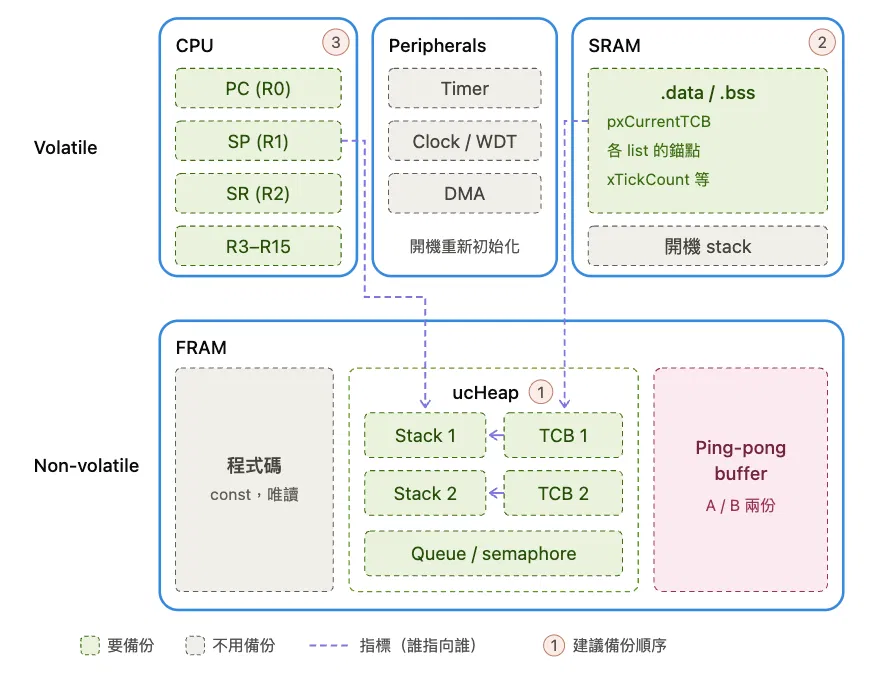

# Lab5

## 1. 題目

- 幫 FreeRTOS 實作 **checkpoint / restore**
- 開發板: MSP430FR5994，配有
    - Volatile Memory: SRAM (8KB)，裡面放 .bss & .data section
    - Non-Volatile RW Memory: FRAM (256KB)，裡面放 ucHeap (task stacks + TCBs)
- 流程提示（from 老師的投影片）：

    ```c
    main() {
        prvSetupHardware();
        restore(); // 如果有 power fail 過，restore 上次的 checkpoint
        // 建 test task、啟動 scheduler
    }

    test_task() {
        while (i++) {
            if (random_condition()) power_off();
            if (i % 10 == 0) commit();
            print(i);
        }
    }
    ```

- 其他要求
    - 用 `rand()` 觸發 power off，但 power fail 的間隔不能一直比 commit 間隔短，否則會 stagnation（永遠卡在同一個點重複失敗）
    - 真的要備份/還原完整的 SRAM（`.bss`/`.data`）、`ucHeap`、CPU registers (只備份一個計數器 `i` 是不合格的，會被扣分)
    - LPM4.5 只是方便測試用的模擬，demo 時還要能承受真的拔電源
        - LPM4.5（Low Power Mode 4.5）：MSP430 最深的低功耗模式，會把 CPU、SRAM、I/O 的電源整個關掉，所以 SRAM 內容會直接消失。只有 FRAM（非揮發性）裡的資料還留著，所以才需要把 SRAM、`ucHeap`、CPU registers 都先 backup 進 FRAM，不然一進 LPM4.5 這些東西就沒了

> [!NOTE]
> 為什麼 restore 的時候 CPU registers 一定要排最後？
> 還原 CPU registers 的 `portRESTORE_CONTEXT` 會先讀 SRAM 裡的 `pxCurrentTCB`，再跟著它跑去 `ucHeap` 裡找 `pxTopOfStack`，把 registers pop 出來 -> 必須等 SRAM 跟 `ucHeap` 都還原成正確值才能還原 CPU registers，不然會讀到舊的或還沒還原的垃圾值。



## 2. 相關 Kernel/Port Function

這個 lab 沒有改 FreeRTOS 本身的排程邏輯，是在 port 層（`portext.asm`）外加兩個新函式，建立在既有的 context-switch 機制上：

- **`portSAVE_CONTEXT` / `portRESTORE_CONTEXT`**：port 層的組語 macro，原本是給一般 context switch 用的。作用是把目前所有暫存器 push 到 current task 自己的 stack 上（save），或是從 stack pop 回暫存器（restore）
- **`pxCurrentTCB`**：FreeRTOS 內部指向「目前執行的 task」的 TCB 的指標。`portSAVE_CONTEXT` 會讀這個指標找到 TCB，再把算出來的 stack pointer 寫進該 TCB 的 `pxTopOfStack` 欄位。
- **`vTaskStartScheduler()`**：啟動 scheduler，讓 FreeRTOS 開始做 context switch、tick interrupt 開始跑

以下逐行解釋 `portSAVE_CONTEXT`/`portRESTORE_CONTEXT`（[FreeRTOS_Source/portable/CCS/MSP430X/portext.asm](/lab5/FreeRTOS_Source/portable/CCS/MSP430X/portext.asm#L49-L71)）做了什麼：

### 2.1 `portSAVE_CONTEXT` 組語

```asm
portSAVE_CONTEXT .macro
    pushm_x	#12, r15
    mov.w	&usCriticalNesting, r14
    push_x r14
    mov_x	&pxCurrentTCB, r12
    mov_x	sp, 0( r12 )
    .endm
```

- `pushm_x #12, r15`：把 `r15` 往下數 12 個通用暫存器（`r15`~`r4`）一次 push 到目前的 stack。
    - 注意：`r0`（PC）、`r1`（SP）、`r2`（SR）、`r3`（常數產生器，不是真正的儲存用暫存器）都不在這裡處理
- `mov.w &usCriticalNesting, r14` / `push_x r14`：把 FreeRTOS 記錄「critical section 巢狀深度」的全域變數也存進 stack，restore 時要用同一個深度還原回去
- `mov_x &pxCurrentTCB, r12`：把 pxCurrentTCB 這個指標變數目前存的值 (也就是 TCB 的位址) 複製進 r12
- `mov_x sp, 0( r12 )`：把 **現在的 SP (Stack Pointer)（剛剛 push 完、往下移動後的位置）** 寫進 `pxCurrentTCB` 指到的 TCB 的第一個欄位，也就是 `pxTopOfStack`（規定一定要是 TCB 的第一個成員）

### 2.2 `portRESTORE_CONTEXT` 組語

```asm
portRESTORE_CONTEXT .macro
    mov_x	&pxCurrentTCB, r12
    mov_x	@r12, sp
    pop_x	r15
    mov.w	r15, &usCriticalNesting
    popm_x	#12, r15
    nop
    pop.w	sr
    nop
    ret_x
    .endm
```

- `mov_x &pxCurrentTCB, r12` / `mov_x @r12, sp`：讀 `pxCurrentTCB` 指到的 TCB 的 `pxTopOfStack`，寫回 SP。把 CPU 的 stack pointer 切換到「這個 task 自己的 stack」
- `pop_x r15` / `mov.w r15, &usCriticalNesting`：把 critical nesting 深度 pop 回來
- `popm_x #12, r15`：從（剛設好的）SP 指的位址，把 `r4`~`r15` 這 12 個通用暫存器 pop 回來
- `pop.w sr`：把 SR（狀態暫存器，含中斷啟用位元）pop 回來
    - 前後的 `nop` 是 FreeRTOS 原生 port 既有的寫法，用來留出指令管線的安全間隔
- `ret_x`：真正的 return 指令，從 stack pop 出「返回位址」直接跳過去。
    - 這個返回位址不是這兩個巨集自己存的，而是呼叫端（例如 `vLab5SaveCurrentTaskContext()`）被呼叫當下，硬體呼叫慣例自動 push 上去的。這就是 R0（PC）實際上被備份的方式，不需要另外寫一行去存它

**為什麼這個 lab 要借用它**：這兩個巨集原本是給 FreeRTOS 正常的 task context switch 用的（task 讓出 CPU 時 `portSAVE_CONTEXT`，排程器選中下一個 task 時對它做 `portRESTORE_CONTEXT`）。這個 lab 沒有重新發明一套「怎麼存/還原暫存器」的邏輯，而是直接重用這組 FreeRTOS 本身已經在用、已經驗證過的機制，包成 `vLab5SaveCurrentTaskContext()`/`vLab5RestoreCurrentTaskContext()`（見 3.2 的 Port Assembly 小節）。

## 3. 做法

### 3.1 Application Code

- refer to : [main.c](/lab5/main.c)

    ```mermaid
    flowchart LR
        A[main] --> A2[prvSetupHardware]
        A2 --> B[main_lab]
        B --> C[prvLab5RestoreIfNeeded]
        C --> D[xTaskCreate prvLab5Task]
        D --> E[vTaskStartScheduler]
        E --> F[prvLab5Task 迴圈]
        F --> G{要 power off?}
        G -- 是 --> H[prvLab5PowerOff 進 LPM4.5]
        G -- 否 --> I{counter % 10 == 0?}
        I -- 是 --> J[prvLab5Commit]
        J --> K[printf 印出 counter]
        I -- 否 --> K
        K --> L[vTaskDelay]
        L --> F
    ```

- **`main_lab()`**：先呼叫 `prvLab5RestoreIfNeeded()`，再建立 `prvLab5Task`、啟動 scheduler
- **`prvLab5Task()`**：每輪迴圈計數 `usCounter++`，用 `rand()` 決定要不要 power off，每 10 次呼叫一次 `prvLab5Commit()`，其餘時候單純印出目前的 counter

> [!NOTE]
> `usCounter` 是 `prvLab5Task()` 裡的 `static` 變數，住在一般的 SRAM（`.bss`），不是額外存在 `ucHeap` 或 checkpoint 專用區——它能在 restore 後接續原本的數字，純粹是因為「完整 SRAM 備份/還原」這個機制本身就會把它包含進去，不是另外特別處理的。

### 3.2 FreeRTOS / Port Modified

- refer to :
    - [main.c](/lab5/main.c)
    - [FreeRTOS_Source/portable/CCS/MSP430X/portext.asm](/lab5/FreeRTOS_Source/portable/CCS/MSP430X/portext.asm)
    - [lnk_msp430fr5994.cmd](/lab5/lnk_msp430fr5994.cmd)

#### main.c

- checkpoint 相關常數、兩份 backup array（`ucLab5BackupHeap`/`ucLab5BackupSram`/`xLab5BackupHeader`）、persistent selector（`usLab5LastCommitIndex`）宣告：[L63-132](/lab5/main.c#L63-L132)
- `main_lab()`：開機先 restore，再建立 demo task、啟動 scheduler：[L160-174](/lab5/main.c#L160-L174)
- `prvLab5Task()`：demo task 本體：[L178-212](/lab5/main.c#L178-L212)
- `prvLab5Commit()`：先呼叫 `usLab5ValidCopyIndex()` 拿到目前有效的 slot，直接用 `^ 1U` 算出要寫的 slot、用它的 `ulSequence + 1` 算出下個序號（都無效時分別預設 slot 0、序號 1），再依序存 CPU context、把 `ucHeap`、SRAM 複製到那個 slot，最後才寫 `magic` 跟更新 selector：[L215-239](/lab5/main.c#L215-L239)
- `prvLab5RestoreIfNeeded()`：依序還原 `ucHeap`、SRAM，重新設定 tick timer，最後還原 CPU context：[L244-261](/lab5/main.c#L244-L261)
- `prvLab5PowerOff()`：進 LPM4.5 模擬斷電：[L265-272](/lab5/main.c#L265-L272)
- slot 有效性判斷的 helper：[L276-317](/lab5/main.c#L276-L317)

    ```mermaid
    flowchart LR
        A[usLab5ValidCopyIndex 被呼叫] --> B{selector 是哨兵值?}
        B -- 是 --> D{兩個 slot 都有效?}
        B -- 否 --> C{selector 指的 slot 有效?}
        C -- 是 --> R1["回傳 selector 指的 slot
        （正常穩定運作）"]
        C -- 否 --> D
        D -- 是 --> E["回傳 sequence 較大的那個
        （都有效，比新舊）"]
        D -- 否 --> F{只有一個有效?}
        F -- 是 --> G["回傳那一個
        （另一個剛好失效）"]
        F -- 否 --> H["都無效，回傳哨兵值
        （真正第一次開機）"]
    ```

    `prvLab5Commit()` 拿到這個回傳值後：有效的話用 `^ 1U` 算出下次要寫的 slot（避開目前有效的那個）；都無效（哨兵值）就直接用 slot 0，當作第一次 commit。

> [!IMPORTANT]
> Commit 的實際程式碼順序是「先存 CPU context，再複製 heap/SRAM」，跟教材寫的「`ucHeap` → SRAM → CPU registers」順序看起來不一樣是因為 `vLab5SaveCurrentTaskContext()` 是把暫存器 push 到**目前 task 自己的 stack 上**。這個 project 用 `xTaskCreate()` 動態配置 task（`configAPPLICATION_ALLOCATED_HEAP=1`），task 的 stack 其實是 `pvPortMalloc()` 從 **`ucHeap`** 裡切出來的一塊，**所以必須先把暫存器 push 進 stack，接著複製 `ucHeap` 才會包含這份「CPU registers」的內容**

#### Port Assembly (portext.asm)

- 新增 `vLab5SaveCurrentTaskContext`：呼叫 `portSAVE_CONTEXT` 把目前暫存器存到 task 自己的 stack，緊接著呼叫 `portRESTORE_CONTEXT` 立刻還原，讓 C code 可以照常往下執行（不是真正切換 task，只是把「現在的狀態」做成一份可以留在 stack 上的快照）：[L142-153](/lab5/FreeRTOS_Source/portable/CCS/MSP430X/portext.asm#L142-L153)
- 新增 `vLab5RestoreCurrentTaskContext`：只呼叫 `portRESTORE_CONTEXT`，把 restore 進來的 SRAM（裡面有上次存的那份快照）pop 回暫存器，執行流程會接回當初呼叫 `vLab5SaveCurrentTaskContext()` 的地方繼續跑：[L156-163](/lab5/FreeRTOS_Source/portable/CCS/MSP430X/portext.asm#L156-L163)

> [!NOTE]
> CPU registers 的備份沒有另外宣告一個獨立的陣列，是直接借用 FreeRTOS 原生的 context-save 機制（`portSAVE_CONTEXT`，[FreeRTOS_Source/portable/CCS/MSP430X/portext.asm](/lab5/FreeRTOS_Source/portable/CCS/MSP430X/portext.asm)）。因為這個 project 用 `configAPPLICATION_ALLOCATED_HEAP`，task 的 stack 本來就活在 `ucHeap` 裡，借用這個機制讓暫存器被 push 到 stack 上之後，接著整個 `ucHeap` 備份時就會順便被帶走，不需要額外的 register 陣列，也不用多管理一組 ping-pong。

#### Link Command File (lnk_msp430fr5994.cmd)

- 新增 `.lab5_checkpoint : type = NOINIT {} > FRAM2`，讓三個 backup array 透過 `#pragma DATA_SECTION` 放進 FRAM2，且開機時 C runtime 不會把它們清零/重新初始化：[L169-171](/lab5/lnk_msp430fr5994.cmd#L169-L171)

> [!NOTE]
> 三個 backup array 用 `#pragma DATA_SECTION(..., ".lab5_checkpoint")` 綁進這個自訂 section，linker 知道這塊記憶體被佔用、大小是多少，跟只是硬寫一個固定位址（`(uint8_t *) 0x20000`）比起來，不會被日後其他 FRAM2 配置悄悄覆寫，放不下也會在連結階段直接報錯。
